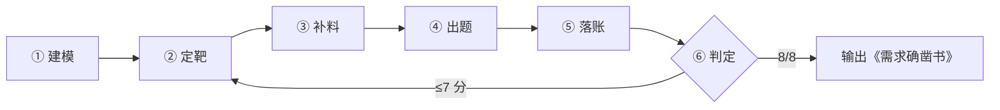

<div align="center">

# 小需 Plus

### 把模糊的想法，问到无可回避的确定结论


<sub>调研驱动的无限轮追问 · 8 项确凿度门禁 · 双模式 · 零脚本 · 零 API Key</sub>

[为什么需要](#为什么需要它) · [工作原理](#工作原理) · [核心机制](#核心机制) · [安装](#安装) · [常见问题](#常见问题)

</div>

---

> **不确凿，不收敛。**  
> xiaoxu v1.0 把想法问成框架，Plus 把框架问成结论。

小需 Plus 是一个**需求确凿化引擎**。它每轮先做调研（补齐你也不清楚的信息），再带着证据出题；所有回答落进一个 8 维状态机；只有 8 项确凿度全部过闸，才允许输出《需求确凿书》。

追问轮次**不设上限**——由确凿度决定什么时候停，不由轮次决定。

---

## 为什么需要它

普通的需求对话，失败方式高度雷同：

|              | 没有小需 Plus         | 有小需 Plus             |
| :----------- | :---------------- | :------------------- |
| **追问深度**     | 问 3–5 轮就收工，对齐了个大概 | 不设上限，8 项全过才收         |
| **提问质量**     | 靠临场发挥，深浅看当时状态     | 每轮先调研，用证据出题          |
| **用户说「不知道」** | 继续追问，逼用户瞎猜        | 转成 AI 的调研任务，查完带选项回来  |
| **模糊回答**     | 「差不多」直接写进文档       | 强制降维成区间选项再落笔         |
| **收敛判定**     | 「可以」就算确认          | 8 项逐项打勾，假收敛信号拦一道     |
| **产出物**      | 一段聊天记录            | 确凿书：证据链 + 否决项 + 验收标准 |
| **返工率**      | 高——需求没对齐就开做       | 低——开工前已无可争议          |

---

## 和 xiaoxu v1.0 的分工

两者**独立并存，不互相替代**。轻量梳理用 v1.0，问到确凿用 Plus。

| 维度       | xiaoxu v1.0 | 小需 Plus         |
| :------- | :---------- | :-------------- |
| 追问轮次     | 固定 3–5 轮    | **不设上限**        |
| 单次出题     | 无明确上限       | 按需，最多 12 道      |
| 提问依据     | 临场发挥        | **每轮先调研**，用证据出题 |
| 五问法      | 固定 5 层      | 按需下潜，够决策即停      |
| 用户答「不知道」 | 继续追问        | **转为 AI 的调研任务** |
| 模糊回答     | 直接沿用        | 强制降维成区间选项       |
| 收敛判定     | 输出框架即结束     | **8 项确凿度全过**    |
| 产出       | 需求框架        | 需求确凿书           |

---

## 工作原理



|     步    | 做什么                                    | 退出条件                  |
| :------: | :------------------------------------- | :-------------------- |
| **① 建模** | 把已知信息压进 8 维状态机，逐维标 `已确证 / 待验证 / 空白`    | 8 维都有状态，首轮出对齐表        |
| **② 定靶** | 挑出**最阻塞收敛的 1–2 项**：P0 优先 → 依赖优先 → 易答优先 | 锁定本轮靶点                |
| **③ 补料** | 判断 L0 直问 / L1 快查 / L2 深调研，产出提问弹药       | 够写出 2–4 个互斥选项即停       |
| **④ 出题** | 按需出题，单次 ≤12 道，主题分组                     | 用户作答或选「不知道」           |
| **⑤ 落账** | 更新状态机 / 假设台账 / 决议日志                    | 三本账同步完成               |
| **⑥ 判定** | 跑 8 项确凿度评分卡                            | 8/8 输出；6–7 二选一；≤5 回 ② |

---

## 核心机制

### 三道闸门

<table>  
<tr><th width="25%">闸门</th><th>作用</th></tr>  
<tr><td><b>8 项确凿度评分卡</b></td><td>逐项 <code>✓/✗</code>，<b>不做 0.5 分</b>（半通过等于不通过）。未满不许输出</td></tr>  
<tr><td><b>5 个假收敛信号</b></td><td>连续三次「你定」、3 项以上靠 AI 猜、单轮从 4 分跳 8 分……命中任一即拒绝收敛</td></tr>  
<tr><td><b>无进展熔断</b></td><td>连续 2 轮不涨分 → 三步诊断（靶选错 / 题型错 / 用户在回避），而不是硬问第 12 轮</td></tr>  
</table>

### 8 项确凿度

|  #  | 项目          | 通过标准                      |
| :-: | :---------- | :------------------------ |
|  1  | **目标可量化**   | 北极星指标 + 基线 + 目标值/方向，三者齐备  |
|  2  | **范围有边界**   | 「本期不做」≥2 项，且与目标不冲突        |
|  3  | **用户与场景具体** | 主角色 + 触发场景，不含「所有人」「随时随地」  |
|  4  | **约束已量化**   | 时间/预算/人力/技术/合规中 ≥3 项有具体数值 |
|  5  | **成功标准可验证** | 交付时能用**一个可观测动作**判定做成      |
|  6  | **关键假设已验证** | P0 假设全部已证实，或用户明确承接风险      |
|  7  | **反例已排除**   | ≥1 条被明确否决的替代方案 + 否决理由     |
|  8  | **用户明确签字**  | 按当前模式判定（见下）               |

> 检验方法：把第 5 项读给一个不相干的人听，他能判断「过了 / 没过」吗？不能就是不通过。

### 分层调研

调研只为**出题**服务，不为「显得博学」服务。

|   档  | 触发条件                  |     成本    | 产出                                |
| :--: | :-------------------- | :-------: | :-------------------------------- |
| `L0` | 上下文已足够，或纯偏好类问题        |     0     | 直接出题                              |
| `L1` | **默认档**：不知道答案就编不出靠谱选项 | 1–3 次双语检索 | 术语校准 / 行业惯例 / 量级锚定 / 可行性红线 / 竞品参照 |
| `L2` | 答案决&#x5B9A;**「该不该做」** |   四阶段全跑   | 可据以决断的结论                          |

**L2 只在 5 种情况下启动**：决定是否该做、关键假设是 P0、用户说「你帮我查」、合规或成本硬门槛、跨市场对比是决策核心。

> 反直觉的一点：**过度调研是 Plus 最大的浪费。** L1 的停止条件是「够出一道好选择题」，不是「覆盖全面」——用户可能一句话就答了。

每枚调研结论必须写成**弹药卡**，含一个强制字段：

```
改变了什么：<原计划选项 → 现在应新增/删除/修改哪个选项>
```

填不出这一栏，调研作废、不入对话。这是防止信息囤积的唯一闸门。

### 三本账

| 账本        | 记什么                          | 解决什么病            |
| :-------- | :--------------------------- | :--------------- |
| **需求状态机** | 8 维 × `已确证 / 待验证 / 空白`       | 知道问到哪了，不重复问      |
| **假设台账**  | 假设 / P0-P2 / 证据 / 状态 / 若错会怎样 | 对抗**静默假设**       |
| **决议日志**  | 选了什么 / 否了什么 / 为什么否           | 支撑「反例已排除」，让未来可复盘 |

> 听到「应该」「大概」「一般来说」立刻记一条假设——**这些词是假设的信号灯**。

### 执行模式

**首轮就会问你选哪种，并把差异摆出来**——不是丢两个术语让你猜。

|            | 严格模式            | 宽松模式（默认）         |
| :--------- | :-------------- | :--------------- |
| **你要多做什么** | 收尾回一句「确认无误」     | 什么都不用做，不提修改意见即通过 |
| **多花的时间**  | 约多 1 轮          | —                |
| **适合谁**    | 要立项、要对齐多方、返工代价高 | 自己先跑起来、探索性需求     |

判定细则：

|           | 严格模式                 | 宽松模式（**默认**）                     |
| :-------- | :------------------- | :------------------------------- |
| **第 8 项** | 必须说「确认无误」            | 未提出修改意见即视为确认                     |
| **视为确认**  | 确认无误 / 就是这个 / 对，按这个做 | 上述任一，或「可以」「行」「收到」「下一步」「直接开工」     |
| **不视为确认** | 「可以」「还行」「嗯」「差不多」     | 继续提修改意见、追问细节、未回应；「差不多」「你看着办」仍判 ✗ |

中途可随时说「严格模式」/「宽松模式」切换。

> **模式只影响第 8 项。** 追问密度、调研深度、评分严格度、三本账——两种模式同样执行。  
> 宽松模式省的是确认动作，不是功课。

### 出题规范

单次最多 12 道，结构固定：

```
1–2 个阻塞靶（必答）  +  最多 10 个伴随确认项  ≤ 12 道
```

按维度分 2–4 组，标注「可只答第一组，其余跳过我按推荐项推进」。

> 12 是**上限不是目标**。能 3 道问清就不出 4 道——凑数会稀释必答题的分量。

### 交付格式

同样是首轮一并确认，选错后面要返工重出。

| 格式               | 适用场景                    | 产物                              |
| :--------------- | :---------------------- | :------------------------------ |
| **Markdown**（默认） | 继续编辑、入库、贴进文档或 PR        | `<项目名>-需求确凿书.md`                |
| **HTML**         | 给不熟悉 Markdown 的人看、发群、打印 | `<项目名>-需求确凿书.html`，单文件内嵌样式，断网可开 |
| **两者都要**         | 既要能改，又要能看               | 两份，内容逐节一致，Markdown 为源           |

---

## 安装

### 通用方式（推荐）

多数宿主都识别 `.agents/skills/`，装这里覆盖面最广：

```bash
git clone https://github.com/chenxiao-reverie/xiaoxu-plus-skill.git \
  .agents/skills/xiaoxu-plus
```

> 目标目录**必须叫 `xiaoxu-plus`**（与 `SKILL.md` 的 `name` 字段一致），否则部分宿主无法加载。本仓库把 `SKILL.md` 放在根目录，克隆时请显式指定目录名。

### 按平台

| 宿主                           | 用户级（全局）                            | 项目级（随仓库共享）                       |
| :--------------------------- | :--------------------------------- | :------------------------------- |
| **WorkBuddy**                | `~/.workbuddy/skills/xiaoxu-plus/` | `.workbuddy/skills/xiaoxu-plus/` |
| **Claude Code**              | `~/.claude/skills/xiaoxu-plus/`    | `.claude/skills/xiaoxu-plus/`    |
| **Codex CLI**                | `~/.codex/skills/xiaoxu-plus/`     | `.agents/skills/xiaoxu-plus/`    |
| **Cursor**                   | `~/.cursor/skills/xiaoxu-plus/`    | `.cursor/skills/xiaoxu-plus/`    |
| **GitHub Copilot / VS Code** | `~/.copilot/skills/xiaoxu-plus/`   | `.github/skills/xiaoxu-plus/`    |
| **Gemini CLI**               | `~/.gemini/skills/xiaoxu-plus/`    | `.agents/skills/xiaoxu-plus/`    |
| **Windsurf**                 | —                                  | `.windsurf/skills/xiaoxu-plus/`  |
| **Kiro**                     | —                                  | `.kiro/skills/xiaoxu-plus/`      |
| **通用目录**                     | `~/.agents/skills/xiaoxu-plus/`    | `.agents/skills/xiaoxu-plus/`    |

### 手动复制 / 软链接

```bash
# 复制
cp -r xiaoxu-plus ~/.workbuddy/skills/

# 软链接：多端同步一份源文件，改一处全局生效
ln -s ~/path/to/xiaoxu-plus ~/.agents/skills/xiaoxu-plus
ln -s ~/path/to/xiaoxu-plus ~/.workbuddy/skills/xiaoxu-plus
```

### 验证

| 宿主          | 验证方式                            |
| :---------- | :------------------------------ |
| WorkBuddy   | 技能列表中出现「小需 Plus」                |
| Claude Code | `/skills` 列表可见，或 `/xiaoxu-plus` |
| Codex CLI   | `/skills` 列表可见                  |

装完没出现，多半是宿主没重扫目录——重启会话即可。

---

## 触发方式

**显式呼叫**　`小需 plus` · `小需+` · `plus 版小需`

**需求类诉求**　`做需求` · `梳理需求` · `需求不清` · `帮我把需求理清楚` · `把需求问到底` · `反复确认需求`

**项目描述**　`我想做一个…` · `帮我设计…` · `帮我规划…`（附带产品、功能、活动、页面、系统等具体对象）

**高返工代价场景**　重大立项 · 需先验证可行性或合规或成本量级 · 需求方自己也说不清

> **不适用**：已有明确规格、只需直接执行的编码、写作、查询、翻译类任务——直接说需求即可。

---

## 输出长什么样

```markdown
# 需求确凿书 · 周报自动化

> 确凿度 8/8 ｜ 追问 5 轮 ｜ 模式：宽松

## 0. 一句话需求陈述
让销售运营在每周五出周报时不再手工汇总 Excel，而由系统自动拉数并生成
模板化周报，把耗时从 6 小时压到 1 小时内。

## 2. 目标与指标
北极星：周报生成耗时 ｜ 基线：6 小时/周 ｜ 目标：≤1 小时/周 ｜ 期限：11/30

## 4. 范围
本期做：数据自动拉取、周报模板生成
本期不做：权限体系（本期单人使用）、移动端（频次低）、历史回填（无需求）

## 11. 确凿度评分
1 目标可量化 ✓   2 范围有边界 ✓   3 用户场景 ✓   4 约束量化 ✓
5 验收可验证 ✓   6 假设已验证 ✓   7 反例已排除 ✓   8 用户签字 ✓
```

完整 12 节含假设台账、决议记录、证据链——见 [`references/output-spec.md`](references/output-spec.md)。

---

## 目录结构

```
xiaoxu-plus/
├── SKILL.md                   触发条件 + 六步循环 + 双模式 + 加载地图   229 行
├── references/
│   ├── questioning.md         8 维状态机 / 五问按需下潜 / 四种题型 / 12 题组织
│   ├── research.md            L0-L2 分层调研 / 五种快查 / 弹药卡 / 四阶段
│   ├── convergence.md         8 项正反例 / 双模式细则 / 假收敛 / 熔断
│   ├── output-spec.md         对齐表 / 三本账 / 确凿书 12 节模板
│   └── anti-patterns.md       12 条反模式与修复动作
├── README.md
└── LICENSE
```

`SKILL.md` 全量加载控制在 230 行内，深度内容按需读取 references——**渐进式加载，不占额外上下文**。

---

## 常见问题

<details>

<summary><b>和 xiaoxu v1.0 有什么区别？该装哪个？</b></summary>

v1.0 是「问成框架」，Plus 是「问成结论」。v1.0 更快，Plus 更狠。两者可以同时装——日常轻度梳理用 v1.0，重大立项用 Plus。

</details>

<details>

<summary><b>一次问 12 道，会不会很啰嗦？</b></summary>

12 是上限不是目标。实际结构是 1–2 道必答 + 若干可跳的顺手确认，必答项永远排第一组。你可以只答必答题，剩下的跳过我按推荐项推进。

</details>

<details>

<summary><b>用户说「不知道」会怎样？</b></summary>

不会继续追问。它会把问题转成自己的调研任务（L1 快查或 L2 深调研），查完带着选项回来。这是 Plus 与普通需求对话最大的差别。

</details>

<details>

<summary><b>宽松模式会不会变成假收敛？</b></summary>

宽松只降低第 8 项的确认门槛，另外 7 项和 5 个假收敛信号照常生效。而且两种模式共用同一套追问密度与调研深度标准——宽松省的是确认动作，不是功课。

</details>

<details>

<summary><b>到底要问几轮？会不会没完没了？</b></summary>

不设上限，但设了熔断：连续 2 轮评分不涨就停下来诊断，而不是继续硬问。常见需求 4–8 轮，复杂立项可能十几轮。

</details>

<details>

<summary><b>推荐的技能本机没有怎么办？</b></summary>

推荐前会核对宿主实际可用的技能列表；没有列表就改用技能搜索；连搜索都没有就只给能力建议，**不编造技能名**。

</details>

<details>

<summary><b>装完不生效？</b></summary>

多数是宿主没重扫目录，重启会话。若仍未出现，按顺序检查：目录名是否为 `xiaoxu-plus`、`SKILL.md` 大小写是否正确、frontmatter 是否含 `name` 与 `description`。

</details>

---

## 二次开发须知

<table>  
<tr><th width="30%">约束</th><th>要求</th></tr>  
<tr><td><code>name</code></td><td>小写字母数字连字符，<b>必须与目录名一致</b></td></tr>  
<tr><td><code>description</code></td><td>≤1024 字符，同时写清「做什么」与「何时用」；<b>触发词只能写这里</b></td></tr>  
<tr><td>frontmatter</td><td>仅 <code>name</code> / <code>description</code> / <code>license</code> / <code>allowed-tools</code> / <code>metadata</code>；<b>不加 version、author</b></td></tr>  
<tr><td>YAML</td><td>描述里避免未加引号的「冒号 + 空格」，会被误判为键值分隔</td></tr>  
</table>

---

## 安全提示

本 Skill 为**纯 Markdown，零脚本、零依赖、零 API Key**，不发起任何外部请求，仅复用宿主的检索与网页抓取能力。安装前建议像审查代码一样通读 `SKILL.md`。

---

<div align="center">

**MIT** © [chenxiao-reverie](https://github.com/chenxiao-reverie)

先问清楚，再动手 —— 问到确凿，才算问清楚。

</div>
